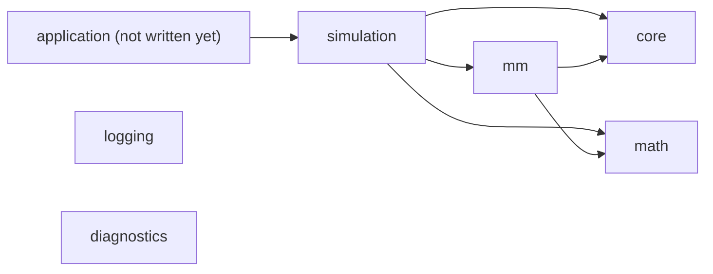

# Architecture

These pages explain why the code looks the way it does. They are written for
someone who has read a header and wondered "why this way?". What a function does
is in the headers; what was chosen, and what was turned down, is here.

Pages marked *planned* describe things that are decided but not built yet. They
are kept apart in `future/` so nobody mistakes them for the current code.

## How it fits together

Read [overview](overview.md) first. After that, the pages follow the order in
which data moves through a tick.

## What exists today

| Page | What it covers |
|---|---|
| [Overview](overview.md) | The modules, the dependency rule, why every module is a shared library |
| [Randomness](randomness.md) | Counter-based generators, one stream per subsystem and asset, why assets are keyed by symbol |
| [Price processes](price-processes.md) | Random walk and factor model, arithmetic and geometric dynamics, correlation |
| [Order book and matching](order-book-and-matching.md) | The book, the matching engine, the latency queue |
| [Market making](market-making.md) | Avellaneda-Stoikov quoting, risk limits, requoting, the P&L ledger |
| [The simulation loop](simulation-loop.md) | What `World` holds, the order of events inside a tick, adverse flow, latency |
| [Observers and results](observers-and-results.md) | How a run reports what happened and how the results are built |
| [Logging and diagnostics](logging-and-diagnostics.md) | Leveled logging and exceptions that carry their own stack trace |
| [Build and CI](build-and-ci.md) | Presets, vcpkg, the pipeline and why it is shaped the way it is |
| [Performance](performance.md) | The time budget and how to measure against it |
| [Known limits](limitations.md) | What the model gets wrong or leaves out |

## What is planned

| Page | What it covers |
|---|---|
| [Agents and the human seat](future/agents-and-human-seat.md) | Bots, a person trading or making the market, who owns an order |
| [Real time and threads](future/real-time-and-threads.md) | One thread owns the world, speed 1x, 10x, 100x |
| [Save and resume](future/save-and-resume.md) | Snapshots and an event journal |
| [Dynamic assets](future/dynamic-assets.md) | Listing assets while a run is going |
| [Sweep mode](future/sweep-mode.md) | Many runs of the same engine, and a spectator mode |
