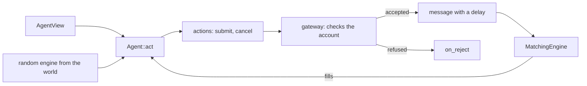

# Agents

An agent is anything that trades: a market maker, a bot, one day a person. The `agents`
module defines what an agent is shown and what it can ask for, and the bots. It decides
nothing about money or timing. `simulation` holds the accounts, applies the rules of the
exchange and calls the agents.

## The interface

`Agent::act(view, rng, out)` appends what the agent wants to do to `out`. Appending
nothing is the usual answer. An action is plain data: a limit order, a market order or a
cancel. It holds nothing that points back into the engine, so it can be copied, logged and
one day sent across a boundary.

Besides `act`, an agent is told about its fills (`on_fill`) and its refusals (`on_reject`),
and can save and restore its own state as opaque bytes.

An agent must be deterministic. It has no clock, no threads and no random numbers of its
own. The random engine comes in as an argument and belongs to the world, so a run replays
exactly and a resumed run stays exact.

## What an agent is shown

`AgentView` is built by the loop each time the agent is due. The spans point into buffers
the loop owns and are valid for the call only.

- **The market, per asset**: the best levels of each side of the book (how many is
  `book_depth` in the config), the trades since the agent last looked, up to 50, and the
  tick size.
- **The true price**, as `signal`, only for agents that are meant to have it. Today that is
  the market maker, which quotes around it, and informed flow. Everyone else reads the
  book.
- **The common factors**: the sum of their moves since the agent last acted. Only the
  factor traders get them.
- **Its own account**: cash, buying power, positions.
- **Its own orders**, each with a state: on its way to the exchange, resting, or being
  cancelled. Without the first state an agent that acts every tick would send the same
  quote again and again while the first one is still in flight.
- **Time**: the tick, the time, and the time since it last acted, for a strategy that
  feeds an estimator with returns per unit of time.

The market data can be late. See [timing](#timing).

## The gateway

An action is checked against the agent's account before it goes anywhere. A refusal calls
`on_reject` and is counted in the results by reason. These are the rules, in the order they
are checked:

| Reason | When |
|---|---|
| `UnknownAsset` | no such asset |
| `InvalidOrder` | a quantity of 0 or less, or a price that is not finite and positive |
| `PositionLimit` | past the agent's `max_abs_position` once its pending orders fill |
| `ShortNotAllowed` | a sale of more than it holds, from an agent that may not short |
| `InsufficientCollateral` | a short sale that would take buying power below zero |
| `InsufficientCash` | a buy that would take buying power below zero |

Buying power is cash, minus what pending buys reserve, minus the collateral held for
shorts. A buy reserves its price times its quantity. A market buy has no price, so it is
valued at the last mid plus a buffer (5 % by default). A short reserves a share of the
position's value, 100 % by default, so a short gives no leverage unless you lower it. The
same rules apply to every agent, the market maker included.

Reducing a position is always accepted, even past a limit or with negative buying power,
so an agent can always get out. Nothing liquidates an account that loses too much.

Actions are judged one after the other, so the reserve of the first counts against the
second. Cancelling an order that is already gone is not an error and says nothing.

## Who owns an order

The matching engines know nothing of agents, and their order ids are per engine, so two
assets both have an order 1. The loop keeps a registry from (asset, order id) to the agent
and the ticket that placed it. A trade names two order ids, and the registry says whose
accounts to settle.

`core` is unchanged. An order has no owner there, and nothing in `core` had to learn about
agents.

### An agent never trades with itself

An engine can be told, for the order it is matching right now, which resting orders belong
to the same owner. When the incoming order would trade with one of them, the engine cancels
the resting one and carries on matching what is behind it. The older order goes. Own orders
also do not count towards a fill-or-kill.

This replaces what the first loop did, which was to book a market maker crossing its own
stale quote on both sides and net it to nothing. That produced a trade that never happened
on a real exchange.

## The agents

All of them are in `agents`, built from plain data by one function, `make_agent`.

| Agent | What it does |
|---|---|
| Market maker | The Avellaneda-Stoikov strategy of [market making](market-making.md), as an agent. Reads the true price, asks the strategy for quotes, sends only what changed. |
| Informed flow | Takes liquidity with immediate-or-cancel market orders. The number of arrivals is Poisson with mean `lambda` times the time since it last acted. Each follows the last move of the signal with probability `rho`, otherwise a fair coin. |
| Noise trader | Poisson arrivals, a coin for the side. Either a market order or a passive limit order a few ticks from the book mid. Keeps at most a fixed number of resting orders and cancels the oldest. Its draws do not depend on the book. |
| Trend follower | Compares the book mid to its exponential average. When it is far enough above, buys; far enough below, sells. A fixed size, and never past its position limit. |
| Mean reverter | The same signal, the opposite side. |
| Factor trader | Sums the factor moves times its sensitivities. Past a threshold it trades every asset on the sign of that score. |

The bots read the book mid, the average of the best bid and ask, with the last trade as a
fallback and nothing at all on an empty book. They never see the true price. The tick size
is a property of the exchange, the same for everyone.

### Adding a kind of agent

The kinds are a closed `std::variant`, `AgentBehavior`, and `make_agent` is the one place
that visits it. Adding a kind is one new alternative and one branch. A runtime extension
mechanism, where code that is not in the project supplies an agent, is not built. When
plugins start, the plan is one more alternative holding a factory, so the closed list stays
closed.

## Timing

Each agent has its own `AgentTiming`:

- **`decision_period`**: how often it looks at the market. It acts at the first tick where
  at least that much time has passed since it last acted. A broker watches every tick. A bot
  that checks in once a minute does not. Two agents with the same appetite for risk but
  different timing are different participants.
- **`order_delay`**: how long its orders and cancels take to reach the exchange. Each message
  draws one delay from the agent's own latency stream.
- **`info_delay`**: how old the market data in its view is, drawn each time it acts. Its own
  orders and account are always current. It knows its own fills.

Agents act in the order of the config, and messages due at the same time reach the exchange
in that order. A replacement never reaches the exchange before the cancel of the order it
replaces. That is how a trader listed before the market maker hits the previous tick's
quotes.

## How the loop keeps the market's past

`MarketHistory` keeps what an agent may be shown late. Every tick it records a snapshot (the
best levels of each book and the true prices) and puts the trades since the last tick on a
tape. An agent is shown the newest snapshot that is at least `info_delay` old, and the trades
on the tape it has not seen yet.

The two are kept for different lengths because they cost differently. Snapshots hold whole
book sides, and an agent never looks back further than its delay, so they cover the longest
delay in the config. The tape is a few numbers per trade and has to cover the longest delay
plus the longest decision period, since an agent that acts rarely must be shown everything
since it last looked. An exponential delay has no longest value: it is covered up to 30
times its mean.

## Randomness

Each agent has two streams, derived from its name: one for its decisions and one for the
delays of its messages. Adding, removing or reordering agents changes nothing about the
others. See [randomness](randomness.md). The draws do not depend on outcomes: a refused
action still draws its delay, so a refusal never shifts a later draw.
