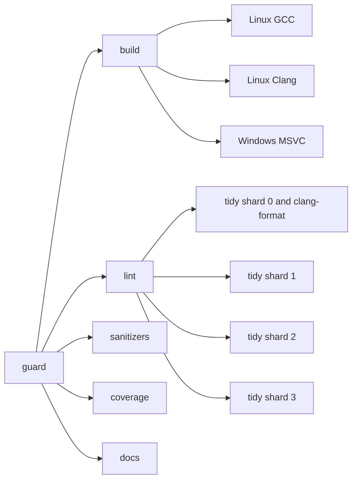

# Build and CI

## The build

CMake with vcpkg in manifest mode. `vcpkg.json` pins a baseline, so the dependency
versions are the same on every machine. Optional dependencies are vcpkg features:
`tests` brings Catch2 and Trompeloeil, `benchmarks` brings nanobench. A build that does
not ask for them does not download them.

Every module is a shared library, with generated export headers. See the
[overview](overview.md) for the reason.

Tests and benchmarks need no CMake edit: every `modules/<name>/tests/*.cpp` becomes its
own test executable and every `modules/<name>/bench/*.cpp` its own benchmark. A new file
is picked up on the next configure.

### Presets

| Preset | For |
|---|---|
| `dev` | Debug with tests and benchmarks, warnings as errors. What CI builds. |
| `dev-mingw` | The same with MSYS2 g++, for working on Windows without Visual Studio. |
| `release`, `release-mingw` | Release with link-time optimisation. No tests, no benchmarks. |
| `bench`, `bench-mingw` | Release with benchmarks only. The only honest way to measure. |
| `asan` | Debug with AddressSanitizer and UBSan. |
| `coverage` | Debug with coverage instrumentation. |

`dev` builds the benchmarks but does not run them. Debug timings mean nothing, which is
why `bench` exists.

## The pipeline

One workflow, `.github/workflows/ci.yml`. A cheap first job checks that there is any
C++ under `modules/` or `src/` at all, so a bare checkout does not burn minutes.

- **Build** runs the tests on GCC, Clang and MSVC. Three compilers because each one
  catches different mistakes, and MSVC in particular catches missing export macros that
  MinGW lets through.
- **Lint** runs clang-format and clang-tidy. clang-tidy is split over four runners.
- **Sanitizers** runs the tests under ASan and UBSan.
- **Coverage** produces a report as an artifact.
- **Docs** builds the Doxygen reference as an artifact.

### clang-tidy

It used to take about 22 minutes for the whole project and now takes a few. Three
changes did it:

- **Test and benchmark files are skipped.** They were most of the run time, and most of
  the noise: every Catch2 macro expands into code that gets analysed too. Their headers
  are still checked through the sources. `MMS_TIDY_INCLUDE_TESTS=1` brings them back.
- **Four shards.** The file list is split four ways, one runner each, because each runner
  has its own cores.
- **On a pull request, only what changed.** A changed header re-checks every file of its
  module, since any of them may include it. A change to `.clang-tidy`, to a CMake file, to
  a preset, to `vcpkg.json`, to the lint script or to the workflow re-checks everything.

Diagnostics from code that is not ours (the standard library, Eigen, Catch2, fmt) are
filtered out by `SystemHeaders: false` and an anchored `HeaderFilterRegex`. I do not want
warnings about code I did not write.

The log prints `start` and `done` with a duration for each file, so a slow or stuck file
shows up.

### The vcpkg cache

Building the dependencies from source is the slowest part of a cold run, so the binary
cache is saved between runs. The key includes the run id, so every run can save a fresh
cache. A key that depends only on `vcpkg.json` stays a hit for ever and never gets saved
again, and when the runner image changes its compiler, every package's ABI hash changes
with it. The cache then sits there, stale, restoring nothing. Restoring falls back through
older keys by prefix, and saving happens even when the build fails, so a failed run still
leaves the work it did.

### Windows and the DLLs

On Windows the tests run next to their DLLs, and several test executables used to copy the
same DLLs at the same time and collide. Copying is now done under a file lock
(`cmake/Scripts/StageRuntimeDlls.cmake`).

### Formatting

clang-format is enforced. `ci/check-format.sh` fails on any difference, so style is never
a review comment.
