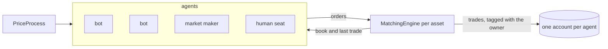

# Agents and the human seat

*Planned. Nothing here exists in the code yet.*

Today the market has one participant that thinks, the market maker, and a source of
random market orders, adverse flow. The product I want is a sandbox: many bots with
their own habits, and a person who can sit among them and trade.

## What is decided

- **Many bots.** Each has its own sensitivity to the price factors and its own starting
  cash. Heterogeneous on purpose, so the market does not behave like N copies of one
  participant.
- **A seat for a person.** A human can be a free trader, a market maker, or either. The
  role is a setting of the seat, not a different program.
- **Cash is configurable** per simulation, for the bots and for the person.
- **The same engine.** The matching engine, the price process and the tick loop stay as
  they are. What changes is who submits orders and who is charged for them.

## What has to change

These come from reading the code, not from a design yet.

- **An order needs an owner.** Orders carry none, and ids are per engine, so two assets
  both have an order 1. The simulation will need a mapping from (asset, order id) to an
  agent, held outside `core`, so the matching engine stays ignorant of agents.
- **One ledger per agent, with cash.** Today there is one `PnlLedger` for the portfolio
  and it has no cash balance, only positions and fees. Each agent needs an account with
  cash and its own positions.
- **The fixed-size vectors.** `StrategyConfig`, `RiskLimits`, `LiveQuoteSet` and `Results`
  are all sized to the asset list at construction. They have to grow with the asset list
  (see [dynamic assets](dynamic-assets.md)) and be per agent.
- **`World` and `TickLoop` are shaped around one market maker.** The loop schedules
  "the" strategy's quotes and tells adverse flow apart from the maker's trades by order
  id. With several agents that logic has to be general.
- **Adverse flow stops being special.** It is a stand-in for participants who are not
  modelled. Once bots exist, informed bots can do what it does, and it can stay as noise
  or go.

## What is open

Six questions that are not answered yet. They are listed here as questions on purpose,
not as decisions:

1. **Who owns an order**, and where the mapping lives.
2. **The agent interface.** What a bot is given each tick and what it can return. Probably
   orders and cancels, in the same vocabulary as the market maker's requests.
3. **Account rules.** Can an agent go short? Is there a borrow cost? What happens when
   cash runs out: reject the order, or let the balance go negative?
4. **The first bots.** Which behaviours to build first. A noise trader, a trend follower
   and a mean reverter are the obvious starting set.
5. **What an agent sees.** Only its own book and the last price, or the whole depth. Seeing
   the true price would be cheating, as it is for the market maker today.
6. **Time and speed.** How an agent's decisions are paced against the tick, and what a
   human's reaction time means at 10x. See [real time and threads](real-time-and-threads.md).

The market maker is the first agent. The risk is making it a special case of the
interface by accident. Writing the interface from the market maker's side, and then
checking that a bot fits it, is the way to avoid that.
