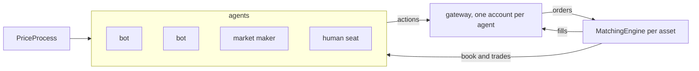

# Agents and the human seat

*Partly built. The agents exist, the seat for a person does not.*

The product I want is a sandbox: many bots with their own habits, and a person who can sit
among them and trade. The bots are built. See [agents](../agents.md). This page is about the
person, and about the bots that are still missing.

## What is built

- A market with several agents, each with its own cash, rules, speed and delays.
- An account per agent, with the same rules for everyone, the market maker included.
- Ownership of every resting order, and self-trade prevention.
- Six kinds of agent: the market maker, informed flow, a noise trader, a trend follower, a
  mean reverter and a factor trader.
- Results per agent.

## What is decided for the seat

- **A seat for a person.** A human can be a free trader, a market maker, or either. The role
  is a setting of the seat, not a different program.
- **The same interface.** The person is an `Agent`. What the person sees is an `AgentView`
  and what the person sends is a list of actions, the same vocabulary as a bot's. The gateway
  checks them like any other. That was the point of writing the interface from the market
  maker's side and then checking that a bot fits it.
- **Cash is configurable** per simulation, for the bots and for the person.
- **Pace is the person's own.** A person does not act at a fixed period. The seat is an agent
  whose actions arrive from outside the tick, stamped with the tick they were applied at. That
  is also what the journal in [save and resume](save-and-resume.md) needs.

## What is open

- **How a person's input reaches the loop.** `act` is called by the loop and returns. A person
  answers at human speed, from another thread. The seat has to hand its actions to the world
  thread without making the loop wait. See [real time and threads](real-time-and-threads.md).
- **What a person sees.** The same view as a bot, or a richer one. A screen shows more than a
  bot needs, but nothing the bot could not have.
- **Reaction time at 10x and 100x.** At 100x a second of the person's time is a hundred
  market seconds. Whether that is a feature or a handicap is a design question.
- **Which bots next.** A noise trader, a trend follower and a mean reverter exist. A
  participant that trades on a view of fair value, or one that reacts to the others, does not.
- **Plugins.** A way to bring an agent from outside the project, so that a new bot needs
  no change to it. The plan is one more kind of agent that holds a factory, and the application
  first. See [agents](../agents.md).
