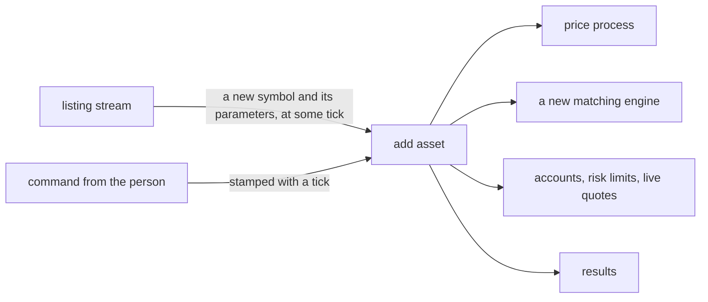

# Dynamic assets

*Planned. The set of assets is fixed when a `World` is built.*

Assets will be listed while a run is going. Some by the person, some at random moments
with no one asking, the way a new company goes public. The random ones are drawn from the
simulation's seed, so a run with random listings is still a run you can replay.

## What is decided

- Assets can be added **during** a simulation, not only at the start.
- Random listings come from a **dedicated random stream**, so the journal stays
  deterministic: replaying a run lists the same asset at the same tick.
- Adding an asset must not disturb the others. That is what the stable key by symbol is for.

## What already helps

- **The key is the symbol.** An asset's random streams do not depend on where it sits in
  the list. A listed asset gets its own streams and no other asset's draws change. See
  [randomness](../randomness.md).
- **The factor model is cheap to extend.** A new asset is a new row of betas and an
  idiosyncratic volatility. The existing assets' paths do not depend on it, because each
  one only depends on its own stream and the factor streams. See
  [price processes](../price-processes.md).
- **A strategy already copes with a cold asset.** An asset whose volatility estimator has
  too few samples is not quoted (`min_samples`), which is exactly what a new listing is.

## What does not help yet

- **The dense random walk cannot take new assets.** Its Cholesky factor changes when the
  matrix grows, which would move every other asset's price. Dynamic listing means the
  factor model.
- **Everything sized to the asset list at construction.** `StrategyConfig`'s per-asset
  vectors, `RiskLimits`, the `LiveQuoteSet`, the ledger and `Results` are fixed length.
  Each has to learn to grow by one asset in the middle of a run, and `TickLoop`'s
  per-asset tables with them.
- **`FactorModel` has fixed vectors too.** Adding an asset means growing its prices, betas
  and engines. It is cheap, but it is a new operation that the class does not have.
- **Asset ids are positions.** `AssetId` is an index into the list. That is fine while the
  list only grows. Delisting would break it, and nothing plans for delisting yet.

## What is open

- **Where a new asset's parameters come from.** Its starting price, its volatility, its
  betas, its fee. Drawn from distributions in the config, or given by the person?
- **How other participants find out.** A bot has to be told a new asset exists.
- **Delisting.** Not decided, and it changes how ids work.
- **Whether results keep a row for an asset that appears at tick 3000.** It needs a start
  time of its own to mean anything.
