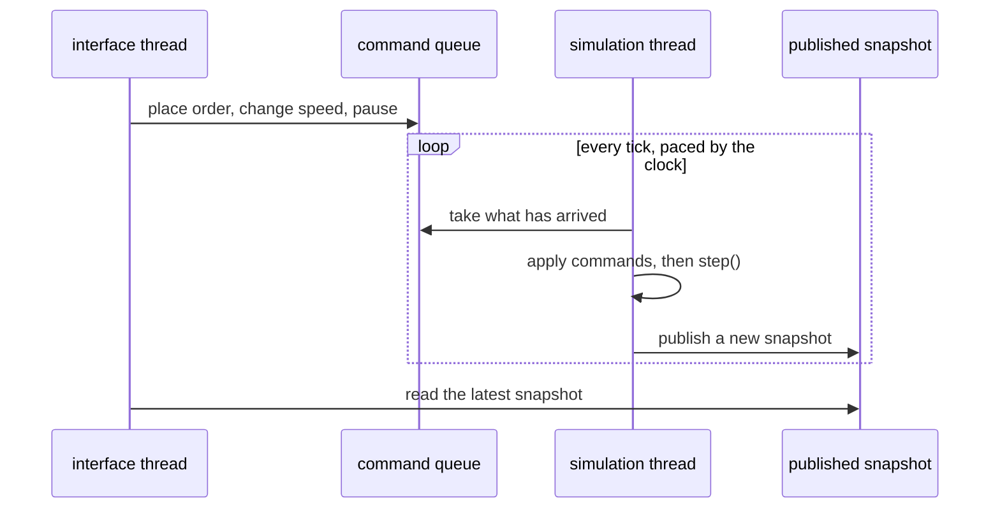

# Real time and threads

*Planned. The engine is single-threaded and has no clock today.*

The simulation will run against the wall clock: you watch it move and you can act
in it. That is not the same program as the batch run that exists now, but it is the same
engine.

## What is decided

- **One tick is one second of market time.** At real speed a tick has a second to finish.
- **A speed multiplier**: 1x, 10x, 100x. At 10x a tick has 100 ms, at 100x 10 ms. See
  [performance](../performance.md) for how that compares with what is measured.
- **The simulation thread owns the `World`.** Nothing else touches it.
- **The interface thread talks to it through two channels.** Commands go in on a queue.
  Snapshots come out, published by the simulation thread, read by whoever draws.

## Why one owner and a queue

The alternative is to lock the `World`. Every observer, every matching call and every
price step would then need to be thread safe, and the determinism the whole project
depends on would be hostage to who got the lock first. With a single owner there is
nothing to lock inside the engine, and it stays the code that is already tested.

The cost is that the interface only ever sees a copy, a tick old at most. For a screen
that is fine.

## Commands are stamped with a tick

A command from the person is applied at the start of a particular tick, and that tick
number is recorded with it. This is what keeps a real-time run reproducible: replay the
journal (see [save and resume](save-and-resume.md)) and every command lands on the same tick
as before, however long the person took.

## An endless run

The runner has a tick count, which is a budget. A live run has no end, so the application
keeps calling `step()` until it is told to stop and ignores the count. Nothing in the
engine needs to change for that, and the statistics in the results are running ones, so
memory does not grow with time.

## What is open

- **Falling behind.** If a tick takes longer than its slot, do we skip ahead, run late and
  catch up, or slow the displayed speed? Skipping ticks would change the result, so it is
  the least likely of the three.
- **What a snapshot contains.** Prices, books, the person's account and open orders, enough
  to draw. Copying everything every tick may be too much at 100 assets. This needs a
  measurement, not a guess.
- **Pausing and speed changes** are commands like the others, so they are stamped and
  journalled. The details follow from that.
