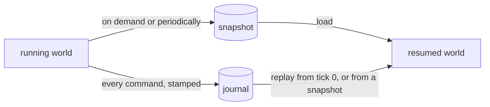

# Save and resume

*Planned. There is no serialisation of any kind today.*

Quit the simulation, come back, and find it in exactly the state it was in. A run that
cannot be reopened is a run that cannot be debugged either.

## What is decided

Both of these, not one:

- **A snapshot**: the whole state of the world at one moment.
- **An event journal**: the seed, the config, and every command from the person, each
  stamped with the tick it was applied at.

They answer different needs.

| | Snapshot | Journal |
|---|---|---|
| Resume fast | yes | no, it replays from the start |
| Small | no | yes |
| Survives a code change | no | no, but it shows what happened |
| Lets you rewind or branch | at the points you saved | from any tick |

A snapshot is for coming back. A journal is for replaying a run to see how it went and
for cutting a run at tick 5000 to try something else from there.

## Why it is feasible

Several earlier choices were made with this in mind.

- **Streams are keyed by symbol and by agent name.** A saved simulation reopens with the same
  random streams for every asset and every agent, whatever order they load in. See
  [randomness](../randomness.md).
- **Agents own no randomness and can write their state.** The engine comes in as an argument,
  and `save()` and `load()` carry the rest as bytes only the agent understands.
- **Engines are small, copyable values.** A counter-based engine is a key and a counter.
  Saving one means saving two numbers, and position `n` is reached in O(1).
- **Commands are stamped with a tick** and a replay is a pure function of the journal.
- **The engine does no I/O.** Reading and writing a file is the application's job.

## What has to be saved

For a snapshot to be exact, everything that influences the next tick:

- the price process: prices and every engine's position,
- each asset's order book, with order ids, and the next id,
- the event queue, with due times and its insertion counter,
- each agent: its own bytes (`save()`), its account with cash and positions, its tickets and
  its list of orders, its decision clock and the factor moves it has gathered,
- the loop: the registry of who owns each resting order, the history of snapshots and trades
  that agents are shown, the clock.

The loop's in-flight bookkeeping is the easy one to forget. A snapshot that leaves it out
resumes in a state that never existed.

## What is open

- **The file format.** JSON and TOML libraries are already in `vcpkg.json` for the
  application layer. A format that is readable by a person is worth some size, but nothing
  is chosen.
- **Versioning.** A snapshot written by one version of the code must be refused, with a
  clear message, by a version that cannot read it.
- **Bit-exactness across machines.** Resuming on the same build is exact. Across
  platforms it depends on floating-point behaviour that is not pinned down yet. See
  [known limits](../limitations.md).
- **How often to snapshot** a long real-time run, and whether to keep several.
