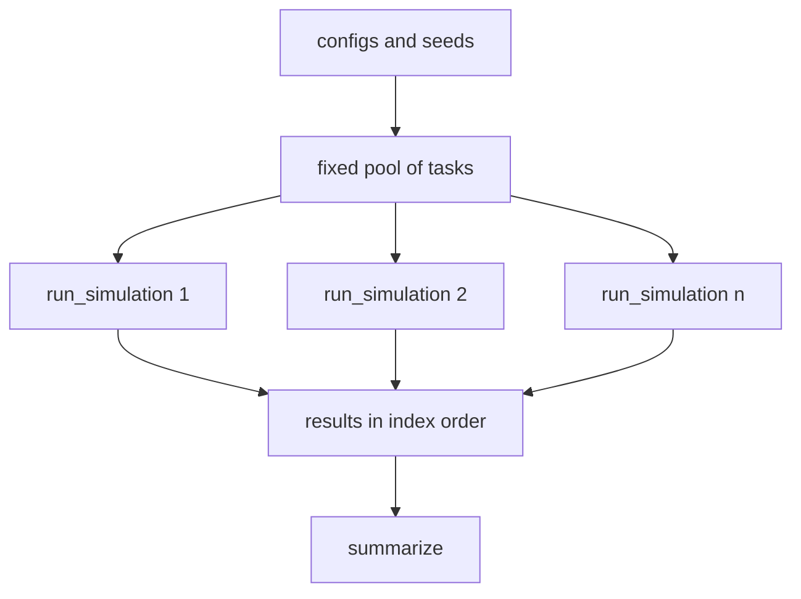

# Sweep mode

*Planned, and the least decided page here. It was put on hold when the product grew into
a sandbox.*

A sweep runs the same engine many times with different configs or seeds, in parallel, and
compares the results. The idea predates the sandbox. `run_simulation(config)` already
exists for it: a function from a config to results, with no shared state.

## Two things that look alike

They are separate on purpose.

- **A sweep** is many runs, none of them watched. The point is the numbers at the end: how
  does the strategy's profit change with gamma, or with latency?
- **A spectator mode** is one run, watched, with no human seat. Same engine as the live
  sandbox, minus the commands. It is the real-time machinery without the person.

Neither needs new engine code. A sweep uses the runner as it is. A spectator mode uses the
[real-time structure](real-time-and-threads.md) and a seat nobody sits in.

## What fits already

- **A run is self-contained.** The runner owns its world, its loop and its observer. It
  cannot be copied or moved, so a sweep builds one inside each task and never passes one
  around.
- **Exceptions propagate unchanged.** A task can catch what a run threw and keep it,
  without the engine deciding anything about failure.
- **Seeds can be derived.** `RngHub::child(index)` gives a sub-hub for run number `index`,
  so replicates get independent streams from one master seed.
- **Logging is per run**, never global. Two runs in parallel do not write over each other.

## What is not decided

The questions were asked and then set aside. These are the leanings, not decisions.

1. **What a sweep is**: a list of configs, a grid over parameters, or a generator that
   produces configs one at a time.
2. **Replicates and seeds.** `R` replicates per config, with seeds derived from the master.
   Using the same replicate seeds across configs (common random numbers) makes differences
   between configs far less noisy, at the cost of the runs not being independent of each other.
3. **Parallelism.** A fixed pool of tasks, one run per task, results stored by index so the
   order does not depend on which finished first.
4. **A run that fails.** Keep the exception for that run and carry on, so one bad config does
   not throw away the other hundred.
5. **Aggregation.** The per-run results, plus a pure function that summarises them.

Progress reporting and cancellation are left out until someone needs them.
