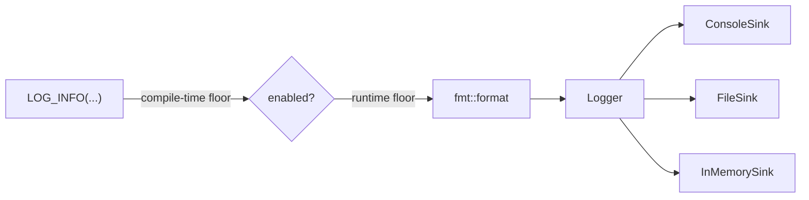

# Logging and diagnostics

Two small modules for reporting. Nothing in the engine uses them yet. They were built
first, on purpose, so that when the application exists it has somewhere to report to and
does not invent it under pressure.

## Logging

There are five levels: Trace, Debug, Info, Warn, Error. A message goes through two gates.

- **At compile time.** `MMS_LOG_COMPILE_MIN_LEVEL` is set by CMake: Trace everywhere
  except Release, where it is Info. A call below the floor expands to nothing. It is not
  skipped at runtime, it is not in the binary. That is why the call sites are macros:
  a function could never avoid evaluating its arguments.
- **At runtime.** `Logger` has its own floor, checked before the message is formatted,
  so a disabled call never pays for `fmt::format`.

`Logger` and the sinks only ever see finished text. A sink is a pure abstract interface
with a single job: take a message at a level and put it somewhere. There are three:
the console (stdout for the low levels, stderr for Warn and Error), a file, and an
in-memory buffer for tests.

### One logger per run, never a global

Every run gets its own `Logger`. A shared global would make two runs, such as the cells
of a parameter sweep, write over each other's output. `Logger::current()` reaches the
active one through thread-local storage, so code deep in `core` can log without a
`Logger&` threaded through every signature.

Only the console is shared between threads, because there is one terminal, and its writes
are serialised by a mutex. The file sink needs no lock because each run owns its own file.
The mutex is not a hot-path cost: nobody logs per tick above Debug.

## Diagnostics

When something throws, the message alone is rarely enough. `Traced<Base>` wraps a
standard exception type and captures, in its constructor, which is the actual throw site
and before the stack unwinds:

- a stack trace (through cpptrace),
- the thread and process ids,
- a timestamp,
- the exception type and the program version.

`format_dump()` assembles that and the message into one report.

`Traced<Base>` inherits publicly from `Base`, so `Traced<std::invalid_argument>` is still
a `std::invalid_argument`. Every existing `catch` and every `CHECK_THROWS_AS` keeps
working. Moving a throw site from `std::invalid_argument` to the traced one is a mechanical
change that cannot break anything, which is how it can be adopted a file at a time. A
catch site that wants the trace asks for the common non-template interface, whichever
exception type was thrown.

The expensive parts are not templates, so `Traced` stays thin however many exception
types use it.

## Why these are separate from the engine

Neither module depends on the other, and the engine depends on neither. `diagnostics`
only ever produces a formatted string, and the catch site decides what to do with it,
which can be handing it to a `Logger`. Everything in `simulation` reports through return
values, exceptions and observers, so a caller who wants no logging gets none and pays for
none.

Adopting `Traced` in the engine's throw sites is open work. Until then the engine throws
plain `std::` exceptions with a message that names the class that rejected the input.
