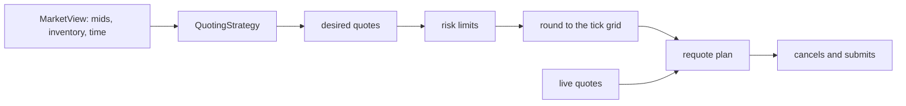

# Market making

The `mm` module holds everything a market maker decides and keeps track of. It does
not move time and it does not touch an exchange. `simulation` feeds it market data,
asks it for quotes, and tells it about fills.



## The strategy

`QuotingStrategy` is an abstract class with one job: given a `MarketView`, return the
quotes to have in the market. The view carries the current mid of every asset, the
signed inventory as doubles, and the time. The conversion from quantity to double
happens once, when the view is built, so no strategy converts a quantity itself.

The two public entry points are not virtual. They check the contract the same way for
every strategy, and the protected virtuals do the work. A strategy is picked once from
a `StrategyConfig` by `make_strategy`, the only place that knows the concrete types.

### Avellaneda-Stoikov, for a portfolio

The one strategy so far. For a single asset, it quotes around a reservation price that
leans against inventory, with a spread that depends on risk aversion and volatility:

```
r         = mid - gamma * tau * sigma² * q
half      = (1 / gamma) * ln(1 + gamma / k)  +  gamma * tau * sigma² / 2
bid, ask  = r - half, r + half
```

`gamma` is risk aversion, `k` describes how fast order arrival falls with distance from
the mid, `tau` is the time horizon.

With several assets the `sigma² q` term becomes `Sigma q`, so holding one asset moves
the quotes on the correlated ones. `Sigma = D R D` is built from the volatilities the
strategy estimates and the configured correlation. It is applied as a product and the
matrix is never formed, which keeps it cheap.

### The strategy estimates its own volatility

It is not told the true volatility of the price process. That would be cheating, and
the gap between the two is part of what makes market making hard. Each asset gets an
estimator: a constant (for tests), an exponentially weighted one whose half-life is in
samples, or a rolling window. `min_samples` says how many observations are needed before
the strategy quotes at all.

### The horizon

`tau` comes from a policy. Either a constant, rolling horizon, or a finite one that
shrinks to a floor as the end of the session approaches. `math` takes `tau` as a plain
number and never decides what it means. That is a strategy choice and it lives in `mm`.

## Ticks

Quotes must sit on the asset's tick grid. A bid is rounded down and an ask rounded up,
so rounding only ever widens the spread and can never cross it. The bid and ask end up
at least one tick apart.

Doubles are not trusted to land on a grid line: 100.3 / 0.1 is 1002.9999999999999. So
the work is done on whole numbers of ticks, which compare and subtract exactly. The
requote threshold below needs that too.

## Risk limits

Two limits: a maximum absolute position per asset, and an optional cap on the portfolio
risk `qᵀ Sigma q`.

A breach does not throw. Being long or short is the normal state of a market maker. The
response is to stop quoting the side that would make things worse. Reducing exposure is
always allowed, even when already past the limit, so a position over the limit can still
get out.

## Requoting

Cancelling a quote that is still good throws away its place in the queue. So the plan
only replaces a quote if its price moved by at least `requote_threshold_ticks`, or if
its size changed. A threshold of 0 replaces every quote every tick.

`plan_requote` is pure. It takes the desired quotes, the live ones and the tick sizes,
and returns what to cancel and what to submit. It knows nothing about engines or clocks.
`simulation` keeps the list of live quotes and carries the plan out.

## Positions and P&L

A `Position` is a signed quantity at average cost. Long and short are both ordinary,
neither is an error. Adding to a position moves the average cost to the volume-weighted
mean, reducing it leaves the average cost alone and realises profit.

The `PnlLedger` owns one position per asset plus cash and fees, and explains profit in
two ways that always agree:

- Accounting: realised plus unrealised.
- Economic: spread captured at the moment of the fill, plus the inventory effect of the
  mid moving while a position is held.

That gives `realized + unrealized == spread_capture + inventory`, which is gross profit.
Fees are a separate bucket on top. Today only the maker fee exists, in basis points of
notional, and a negative value is a rebate. The ledger is fed by `simulation`: `on_fill`
and `on_mark`.

There is one ledger for the whole portfolio. With a single market maker that is right.
With several traders it is not, and
[agents and the human seat](future/agents-and-human-seat.md) says what has to change.
