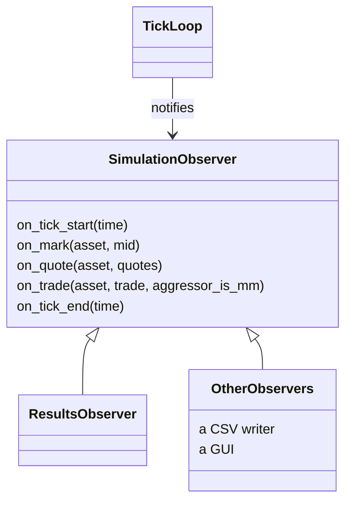

# Observers and results

A run does not return a log. It tells whoever is listening what happens as it
happens, and one of the listeners builds the results.

## The interface

`SimulationObserver` has five events, all with empty default bodies: a tick starts,
an asset was marked at a new true price, the market maker's live quotes on an asset
changed, a trade happened, a tick ended.

The trade event says who was the aggressor, the market maker or adverse flow. A trade
where adverse flow hits nothing of the market maker's still counts, with the aggressor
flag false.

Observers are not owned. The caller keeps them alive for the length of the run, and
several can watch the same one side by side. It is the same pattern as the matching
engine's observer, on purpose: whoever has used one can use the other.

The reason for events instead of a returned log is that different consumers want
different things at different times. A results builder wants a few running numbers. A CSV
writer wants every trade. A GUI wants the current quotes now. None of them should force
the others to pay for what they ignore, and a run that never ends has no "at the end".

## What the results hold

`Results` has one entry per asset, in the order of the config, plus one for the whole
portfolio. Every entry has the same shape:

- The distribution of the per-tick change in total P&L: count, mean, spread, minimum
  and maximum, kept as running statistics.
- The drawdown of the P&L level: its peak and its worst drop.
- How many trades the market maker aggressed and how many adverse flow did.
- The final P&L breakdown (see [market making](market-making.md)).

## How they are built

`ResultsObserver` counts trades as they come. At the end of every tick, when every mark,
fill and quote change of that tick has happened, it reads the ledger. The tick's change
in total P&L goes to the running statistics, and the P&L level goes to the drawdown
tracker.

The drawdown starts from the ledger's level at construction, so a run that only ever
loses is measured from where it began and not from its first loss.

Everything is a running statistic. The observer stores no per-tick history, so memory
does not grow with the length of the run. That is a requirement for a simulation that
runs in real time with no fixed end.

If you want the whole series, write an observer that keeps it. The results observer
does not, and nothing in the engine depends on it.
