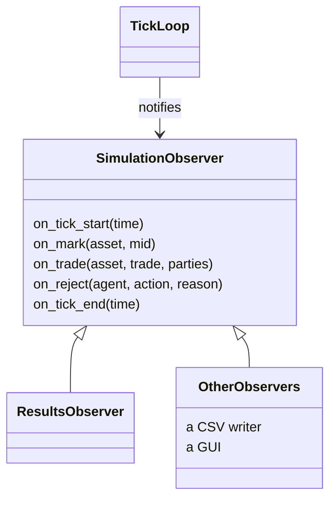

# Observers and results

A run does not return a log. It tells whoever is listening what happens as it
happens, and one of the listeners builds the results.

## The interface

`SimulationObserver` has five events, all with empty default bodies: a tick starts,
an asset was marked at a new true price, a trade happened, the gateway refused an action,
a tick ended.

A trade comes with its two parties: the buyer, the seller, and the side of the order that
started it. `aggressive()` and `passive()` give the agent that took and the agent that was
hit. A refusal comes with the agent, the action and the reason.

Observers are not owned. The caller keeps them alive for the length of the run, and
several can watch the same one side by side. It is the same pattern as the matching
engine's observer, on purpose: whoever has used one can use the other.

The reason for events instead of a returned log is that different consumers want
different things at different times. A results builder wants a few running numbers. A CSV
writer wants every trade. A GUI wants the current state now. None of them should force
the others to pay for what they ignore, and a run that never ends has no "at the end".

There is no event for quotes. What an agent has resting is a fact about the agent, so
`TickLoop::quotes_of(agent)` answers it when asked, instead of the loop deciding for every
listener that quotes are interesting.

## What the results hold

`Results` has one `AgentResults` per agent, in the order of the config. Each one has:

- the agent's name,
- one entry per asset plus one for the whole portfolio, all of the same shape,
- how many of its actions the gateway refused, by reason.

An entry, for an asset or for the portfolio, holds:

- The distribution of the per-tick change in total P&L: count, mean, spread, minimum
  and maximum, kept as running statistics.
- The drawdown of the P&L level: its peak and its worst drop.
- How many trades the agent started and how many hit one of its resting orders.
- The final P&L breakdown (see [market making](market-making.md)).

Every agent has an account and a ledger, so every agent is measured the same way: the
market maker, a bot, and later a person.

## How they are built

`ResultsObserver` is given the agents to watch, each a name and a pointer to its ledger,
and `observed_agents(world)` makes that list from a world. It counts trades and refusals as
they come. At the end of every tick, when every mark and fill of that tick has happened, it
reads each ledger. The tick's change in total P&L goes to the running statistics, and the P&L
level goes to the drawdown tracker.

The drawdown starts from the ledger's level at construction, so a run that only ever
loses is measured from where it began and not from its first loss.

A trade or a refusal naming an unknown asset or agent throws, and counts nothing: the
lookups happen before any counter moves.

Everything is a running statistic. The observer stores no per-tick history, so memory
does not grow with the length of the run. That is a requirement for a simulation that
runs in real time with no fixed end.

If you want the whole series, write an observer that keeps it. The results observer
does not, and nothing in the engine depends on it.
