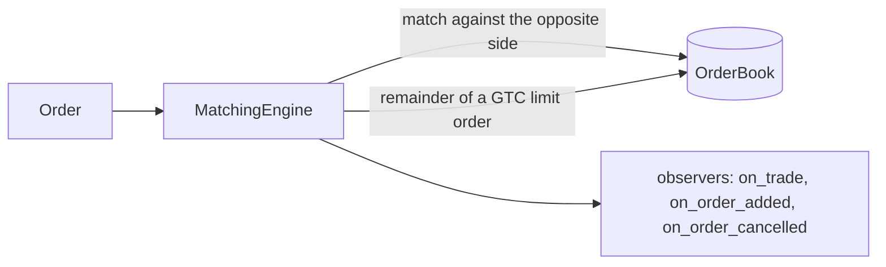

# Order book and matching

This lives in `core`, and `core` knows nothing about market making. It is a plain
exchange: you send it orders, it matches them, it tells whoever is listening what
happened.

## The book is passive

`OrderBook` holds resting limit orders and makes no decision. Each side is a
`std::map` from price to a `std::deque` of entries, so price priority comes from the
map and time priority from the deque. An `unordered_map` from order id to
(side, price) makes cancelling cheap.

Its interface is narrow on purpose: add, cancel, fill, look at the best entry, ask
for depth, list the best few levels with their totals, and count what a given price rule
could match. It does not let you iterate over its insides. That leaves the representation free to change when a
benchmark says so, and nothing outside has to move. The current one is a correct
reference version, not a tuned one. In the benchmark the cost of resting and cancelling
an order barely moves between a book of 10 levels and one of 1000, so there is no
pressure to replace it yet. See [performance](performance.md).

Only good-till-cancelled limit orders ever rest. Market, immediate-or-cancel and
fill-or-kill orders never enter the book.

## The engine is active

There is one `MatchingEngine` per asset. It is not multi-asset, because assets do not
interact at the exchange.

`submit` takes an `Order`, which is a variant of a limit order or a market order. A
limit order can be good-till-cancelled, immediate-or-cancel or fill-or-kill. A market
order can be either of the last two. A market order that rests is not a thing, and
the types say so: its time-in-force enum has no such value. That makes five valid
combinations, and the type system rules out the rest.

What happens to each:

| Order | Matches against the book | Remainder |
|---|---|---|
| Limit, GTC | up to its price | rests in the book |
| Limit, IOC | up to its price | discarded |
| Limit, FOK | only if the whole quantity can fill now | nothing (rejected) |
| Market, IOC | at any price | discarded |
| Market, FOK | only if the whole quantity can fill now | nothing (rejected) |

A trade executes at the price of the resting order, not the incoming one. A rejected
or empty order still gets an id.

The `std::visit` over the order variant is in `submit` and nowhere else in `core`.
A new kind of order is then a change in one function.

The matching loop itself, `match_against_book`, is a free function that mutates the
book and returns the trades without telling anyone. Reporting is the engine's job.
That is what lets the loop be tested with nothing but a book.

## Self-trade prevention

The engine can be told which resting orders belong to whoever is submitting right now, with
`set_self_trade_prevention`. It is off by default. When an incoming order would trade with
one of those orders, the engine cancels the resting one instead, reports it through
`on_order_cancelled`, and carries on matching what is behind it. The oldest order is the one
that goes. Such cancellations are reported before the trades of the same submission, and
the owner's own orders do not count towards a fill-or-kill.

The engine still does not know what an owner is. It asks a function, called only from inside
`submit`, and the caller answers. That is how `simulation` keeps agents out of `core`.

## Observers

`MatchingEngineObserver` has three virtual methods, all empty by default:
`on_order_added`, `on_order_cancelled`, `on_trade`. An observer overrides what it cares
about. Observers are not owned by the engine, and several can listen at once. The
`simulation` module uses this to see every fill without the engine knowing that a
market maker exists.

In the benchmark, a few simple observers add nothing I could measure on top of a
matching call. The virtual calls are cheap.

## Latency queue

`LatencyQueue<T>` delivers payloads at a scheduled time. It is generic: it carries
orders in `simulation`, and it could carry acknowledgements or market data. It never
decides the delay itself; that is a value somebody else draws.

It is built on a heap with an explicit sequence number folded into the ordering key.
A bare `std::priority_queue` does not keep the insertion order of equal keys, and two
events due at the same time must always come out in the same order or the run is not
reproducible. See [randomness](randomness.md) for why that matters.

`drain_until(now)` returns everything due at or before `now`, in due-time order, ties
broken by insertion.

## No owner on an order

An order carries a side, a price, a quantity and a time-in-force. It has no owner, and
ids are per engine, so two assets both have an order 1. The engine assigns ids, and
`simulation` keeps a registry from (asset, order id) to the agent that placed it. See
[agents](agents.md). Keeping the owner out of `core` is deliberate: the exchange does not
know who it is dealing with, and that is what lets the same engine serve a market maker, a
bot and a person.
