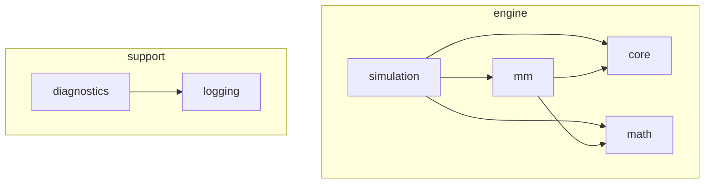

# Overview

MMS simulates a market maker. A price moves, the maker quotes around it, other
participants trade against those quotes, and at the end we count what the maker
made and what it risked. Everything else in the project serves that loop.

## Modules

There are four modules that do the work and two that support them. Each one is
its own library under `modules/<name>/`, with public headers in
`include/<name>/`, sources in `src/`, tests in `tests/` and benchmarks in `bench/`.

| Module | Job |
|---|---|
| `core` | Order book, matching engine, latency queue, order and trade types. Knows nothing about prices or strategies. |
| `math` | Random numbers, distributions, price processes, covariance, running statistics, the Avellaneda-Stoikov formulas. Knows nothing about markets. |
| `mm` | Market-making logic: the quoting strategy, inventory risk limits, requoting, positions and the P&L ledger. |
| `simulation` | The engine: builds a world from a config and advances it tick by tick. |
| `logging` | Leveled logging with pluggable sinks. |
| `diagnostics` | Exceptions that capture a stack trace where they are thrown. |

Dependencies only point down. `core` and `math` do not know each other, and neither
knows `mm`. That is checked by the build: a header that reaches the wrong way does
not compile, because the target is not linked.

`logging` and `diagnostics` are standalone and nothing in the engine uses them yet.
They exist so that the application, once written, has a place to report to.
See [logging and diagnostics](logging-and-diagnostics.md).

## Why `simulation` has no I/O

`simulation` takes a config and returns results. It does not read files, parse
arguments or print anything. The command line, a GUI and a parameter sweep all
need the same engine, and each of them reads its inputs and shows its outputs
differently. If the engine printed, every one of them would have to work around it.

The application layer (`src/app`) will be the only place that touches the
outside world. It is empty today.

## Why `core` and `math` are generic

`core::MatchingEngine` is a template over the price and quantity types. `mm/types.hpp`
is the one place that picks them: price is a `double`, quantity is an `int64_t`.
A quantity is a whole number of shares because fill accounting then stays exact,
and it is signed because a position is negative when short. A price is a double
because it goes straight into Eigen vectors without conversion.

## Why every module is a shared library

The build uses `BUILD_SHARED_LIBS=ON`, one DLL or `.so` per module, with generated
export macros (`MMS_MATH_EXPORT` and so on). The reason is the boundary: a module
that is its own binary cannot quietly reach into another one's internals.

It has a cost on Windows. With MinGW the linker exports every symbol until it sees
the first explicit `dllexport`, so a missing export macro is invisible on one
compiler and breaks on another. Tests are built on MSVC in CI for that reason.

## Time and money

Time is a `double` in the simulation's own unit. One tick is `dt` of it, and every
rate, delay and horizon in the code uses the same unit. When the application
exists, one tick will be one second of market time (see
[real time and threads](future/real-time-and-threads.md)).

## Third-party libraries

| Library | Used for |
|---|---|
| Eigen | Vectors and matrices |
| fmt | Formatting |
| cpptrace | Stack traces in diagnostics |
| CLI11, nlohmann-json, tomlplusplus | Reserved for the application layer: arguments, results, configs |
| Catch2, Trompeloeil | Tests |
| nanobench | Benchmarks |
