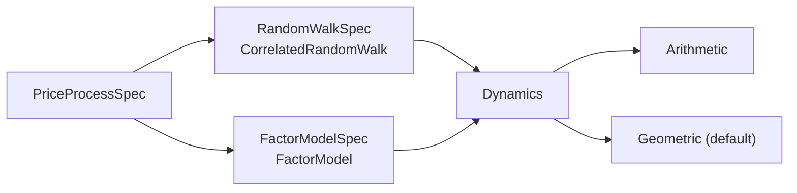

# Price processes

The "true" price of every asset is not the order book's price. It is a hidden
stochastic process that the market maker never sees directly and that adverse flow
reacts to. This page is about that process.

## One process for the whole basket

A `PriceProcess` moves every asset's price in a single call. It is not one object
per asset. The assets are correlated, and the correlation lives in how their random
draws are combined, so a per-asset object would have nowhere to put it. A simulation
therefore picks one mechanism for the whole basket:



`PriceProcess` is a plain abstract class with `advance(dt)`, `prices()` and `reset()`.
It is a virtual call once per tick, which is nothing next to the rest of a tick, and
`simulation` holds it through a `unique_ptr`. `advance` is a non-virtual wrapper that
rejects a negative or non-finite `dt` for every implementation, so no subclass can
loosen that rule.

## Two mechanisms

### Correlated random walk

Every asset gets a normal draw from its own stream. The vector of draws `z` is
multiplied by the lower-triangular Cholesky factor `L` of the covariance and by
`sqrt(dt)`, which makes the increments correlated as configured.

`World` builds the covariance from the per-asset volatilities and the correlation
matrix, `Sigma = D R D`, and factorises it once at construction. The factorisation
is strict: a matrix that is not positive definite is rejected, so a bad correlation
fails at start-up and not in the middle of a run.

Cost is O(N²) per tick, because `L` is dense.

There is a catch. `L` depends on the whole matrix, so an asset's price path changes
when you add another asset that sorts before it. The random streams are independent,
but the mixing is not.

### Factor model

Correlation comes from `k` common factors. Asset `i` moves by its drift plus
`beta_i · f` plus its own idiosyncratic term:

```
step_i = beta_i · f * sqrt(dt)  +  idio_vol_i * z_i * sqrt(dt)
```

The factors are independent standard normals, each on its own stream. Cost is
O(N·k), and with `k` much smaller than `N` that is far cheaper than the dense walk.
At 1000 assets the benchmark has the factor model about four times faster.

The price of that is expressiveness: the correlation matrix is limited to rank `k`
plus a diagonal. In exchange, an asset's path depends only on its own idiosyncratic
stream and the factor streams, never on the other assets. That is the one to reach
for once assets can be listed during a run (see [dynamic assets](future/dynamic-assets.md)).

Factors are independent on purpose. Correlated factors would give back part of the
saving, and nothing needed them.

## Arithmetic and geometric dynamics

Both mechanisms can turn their random increment into a price in two ways.

```
Arithmetic:  p += mu * dt + increment
Geometric:   p *= exp((mu - variance / 2) * dt + increment)
```

Arithmetic is the original. It is simple, and a price can cross zero. With a high
volatility or a long run it eventually does, and a negative price makes no sense for
a market where assets get listed at random and a person trades against the bots.

Geometric keeps a positive price positive. It is the default.

The units change with it. Under arithmetic, `mu` and the volatilities are in price
units per unit of time. Under geometric, `mu` is the expected return rate and the
volatility is relative. So `E[p(t)] = p(0) * exp(mu * t)`, which is what someone
writing `mu = 0.05` means.

The `- variance / 2` term is the Ito correction. Without it, the mean would grow
at `mu + variance / 2`. The variance is the per-unit-time variance of the asset's
log return and is computed inside `math`:

- Random walk: the diagonal of `L Lᵀ`.
- Factor model: the diagonal of `beta L Lᵀ betaᵀ`, plus `idio_vol²`.

`World` does not know any of these formulas. It forwards the chosen dynamics and
nothing else.

Two details worth knowing:

- Geometric rejects an initial price that is not finite and strictly positive.
- The random draws are identical in both modes, in the same order. Switching
  dynamics changes the update formula and nothing else, and the arithmetic
  trajectories did not change when geometric was added.

### Why geometric is the default

It was a two-step decision. First the dynamics became a choice, with arithmetic as
the default so that nothing broke. Then the default moved, because every use planned
for the project needs prices that stay positive. The cost is that a config written
before the change means something else now: a volatility of 1.0 on a price of 100
was fine and is absurd as a relative number. Nothing outside the tests built a
config at that point, so the change was cheap. It would not be later.

## Reset

`reset()` restores both prices and the engines to what they were at construction.
Engines are copied by value at construction for exactly this reason.
