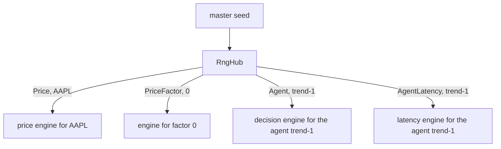

# Randomness

A run is a function of its config and one seed. Same seed, same run, to the last
trade. Almost every design choice here exists to keep that true while the code
around it changes.

## One generator, many streams

The generator is Philox-4x64 with 10 rounds, written in the project (`math/rng`).
It is counter-based: the state is a key and a counter, and the n-th output is a
pure function of both. That gives three things a Mersenne Twister does not:

- Streams that provably do not overlap. Each one gets its own key and its own
  region of the counter space.
- Jumping ahead in O(1). `discard(n)` moves the counter, it does not draw n values.
- A tiny state, about 40 bytes, so thousands of engines stay in cache.

Threefry-4x64 is in the tree as a fallback in case the 64-bit multiply in Philox
ever becomes a portability problem. Nothing uses it today.

## Where the streams come from

`RngHub::engine_for(StreamKey)` is a pure function of the master seed and the key.
A key is a subsystem (`Price`, `PriceFactor`, `Agent`, `AgentLatency`) plus a
key: an asset's, a factor's or an agent's. `World` builds the hub once and hands each
engine to the part of the code that owns it. Engines are held by value, so copying one is a snapshot of
where it is.

### One stream per subsystem and per owner

A trader draws a variable number of values per tick: a Poisson count, then some per
occurrence. If every agent shared one stream, one extra arrival for agent A would shift
every draw that follows, for every agent, for the rest of the run. With one stream each,
A's surprise stays with A. The same goes for the price of each asset.

An agent has two streams, one for its decisions and one for the delays of its messages. The
agent never owns a generator. The world passes the engine to `act`, which is what keeps a
resumed run exact.

The draws do not depend on outcomes. An order that the gateway refuses still draws its
delay, so a refusal never shifts a later draw. A draw that is not needed, such as a constant
delay, consumes no word at all.

### Assets are keyed by symbol, not by position

An asset's key is `asset_key_of(symbol)`: FNV-1a over the bytes of its symbol.
I did not use `std::hash` because the standard lets its result change between
library versions, and a saved simulation has to reopen the same way anywhere.

The first version keyed streams by the asset's index in the list. That worked until
the idea of adding an asset during a run came up: with positions, inserting one
asset renumbers the others and quietly changes all their random draws. Keyed by
symbol, adding, removing or reordering assets leaves the others' streams alone.
`World` rejects an empty symbol and two assets with the same symbol.

Agents are keyed the same way, by name, in subsystems of their own, so an agent called
"AAPL" never shares a stream with the asset "AAPL". Adding, removing or reordering agents
leaves the others' streams alone. A name must be unique and not empty, and
`validate_agent_setup` rejects the rest.

Two subsystems, `AdverseFlow` and `Latency`, belonged to the first loop and nothing draws
from them any more. Their values stay taken, since the list can only grow.

Factors are not assets. Factor `f` uses its index as its key, in its own subsystem
(`PriceFactor`), so its key can never collide with an asset's.

## Transforms are ours

Nothing in the simulation path uses `std::normal_distribution` and friends. Their
output is allowed to differ between standard libraries, which would break
reproducibility for no gain. `math/dist` has its own uniform, exponential, Poisson
and normal samplers.

The normal sampler is an inverse-CDF (probit) on one uniform word. The price step
draws exactly one normal per asset per tick, and Box-Muller produces them in pairs,
which would waste half a draw or force a "keep the spare" state. Probit uses
exactly one word and holds nothing between calls.

## What is promised

On one machine with one binary, the same seed gives exactly the same results.
The tests check it by comparing whole runs for equality.

Across compilers and platforms the generator and the transforms are identical, so
the only room for drift is floating-point arithmetic. I have not pinned that down:
there are no flags forcing `-ffp-contract=off` and Eigen's vectorization is on.
Expect results that agree to rounding, not byte for byte. If a saved run ever has
to replay bit for bit on another machine, that is the work to do. It is listed in
[known limits](limitations.md).
