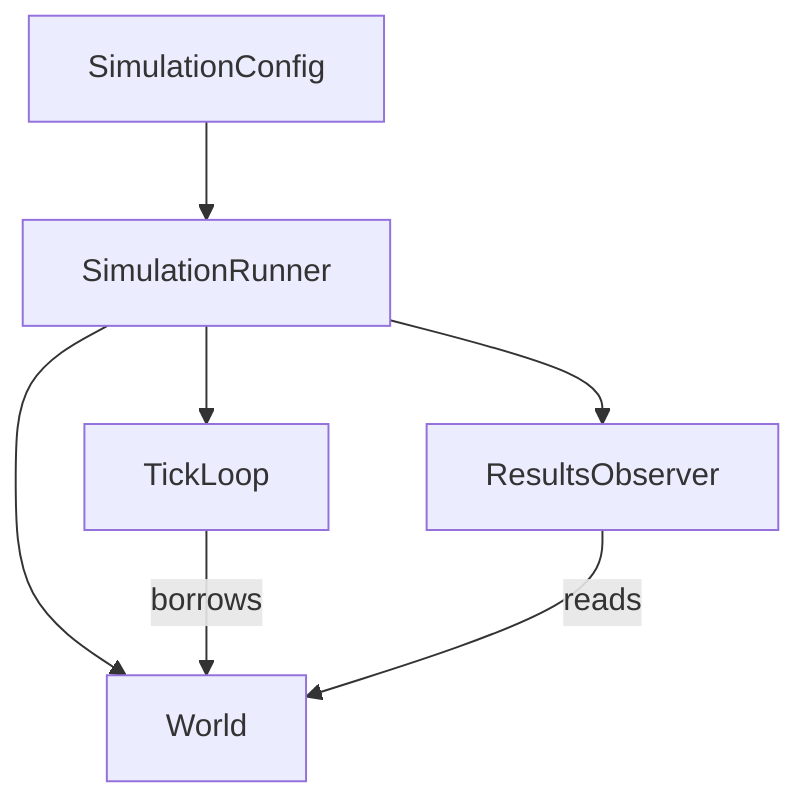
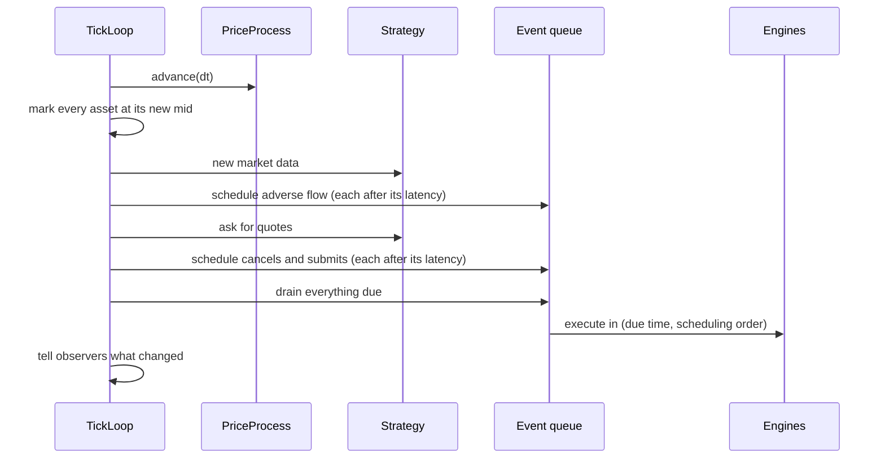

# The simulation loop

`simulation` turns a config into a run. Three objects do the work: a `World` that holds
the state, a `TickLoop` that advances it, and a `SimulationRunner` that owns both and
adds results.

## The config

`SimulationConfig` is plain data: the assets, the correlation, the price process, the
strategy, the latency, the requote threshold, the master seed, `dt` and the number of
ticks. It validates nothing by itself. Each part is checked by whatever uses it, where
the other values it must agree with are at hand. A correlation that is not positive
definite fails when `World` builds the covariance, not in some earlier layer that
cannot know.

All of it is checked at construction. A bad delay spec or a negative threshold throws
before the first tick, not deep into a run.

## The world

`World` builds from the config and holds:

- One `PriceProcess` for the whole basket (see [price processes](price-processes.md)).
- One `MatchingEngine` per asset.
- One event queue for everything on its way to an exchange: the market maker's quote
  submits and cancels, and adverse-flow orders, for all assets together.
- One `PnlLedger` and one `QuotingStrategy` for the portfolio.
- Two random engines per asset, one for adverse flow and one for latency.

It also checks the config against itself: sizes that must agree, no empty or duplicate
symbol, a factor model asset that has its factor data and a random-walk asset that does
not.

## One tick

The order is fixed. It is the same in every run, and changing it would change what the
simulation measures.

The detail that matters most: adverse flow is scheduled before the market maker's own
requests. At equal due times it reaches the exchange first, so it hits the previous
tick's quotes, which are now stale because the price just moved. That is adverse
selection, and measuring its cost is what the whole simulation is for.

Other rules in the loop:

- Events execute at tick boundaries. One that falls due between two ticks runs at the
  next tick, at that tick's mid. Timing is only as fine as `dt`.
- At most one request per asset and side is in flight. A side with a request on its way
  is left alone until the request has executed.
- A replacement never overtakes its own cancel. The loop tracks one order per asset and
  side, and the new quote waits for the cancel to be due.
- If the market maker's new quote crosses its own resting quote on the other side, the
  trade is booked on both sides and nets to nothing. The part that traded against itself
  is not left resting.

## Adverse flow

Adverse flow is what trades against the market maker without being the market maker:
informed or impatient participants. It is always a market order, immediate-or-cancel,
so it only takes liquidity and never rests.

Per asset and per tick:

1. The number of arrivals is Poisson with mean `lambda * dt`.
2. Each arrival picks a direction. With probability `rho` it follows the last price
   move (up means buy). Otherwise it is a fair coin. After an up move the chance of a buy
   is `(1 + rho) / 2`. `rho = 0` is pure noise and `rho = 1` always follows the price.
3. Each arrival has a size: uniform over integers, or exponential rounded to a whole
   share and at least 1.

The draw order is fixed (the count, then for each arrival its direction and its size)
because it is what makes a run reproducible. The functions are pure: the last move is
passed in, not remembered, so each one is tested with nothing but an engine.

## Latency

Every message takes time to reach the exchange: a quote submit, a quote cancel, an
adverse-flow order. A delay is a `DelaySpec`: constant, uniform over a range, or
exponential with a mean. A constant delay consumes no random word. Each asset has one
latency stream, shared by the market maker's messages and adverse flow, since the
generator has one latency key per asset.

Delays are in the simulation's time unit, so a drawn delay adds straight onto the
clock to give the time a message is due.

## The runner

`SimulationRunner` owns a world, a loop and a results observer. It cannot be copied or
moved, because the loop holds a reference into the world and the observer holds one into
the ledger.

`step()` runs one tick and throws `std::logic_error` past the configured tick count.
`run()` runs the rest and does nothing if the run is finished. Exceptions from deeper
down propagate unchanged. A negative tick count is rejected at construction.

`run_simulation(config)` is the same thing as a free function, for callers that only
want the results, such as a parameter sweep.

A run with no end, for a live GUI, is not a mode of the runner. The application keeps
calling `step()` until told to stop, and the runner does not care. The tick count is a
budget, not a requirement.
