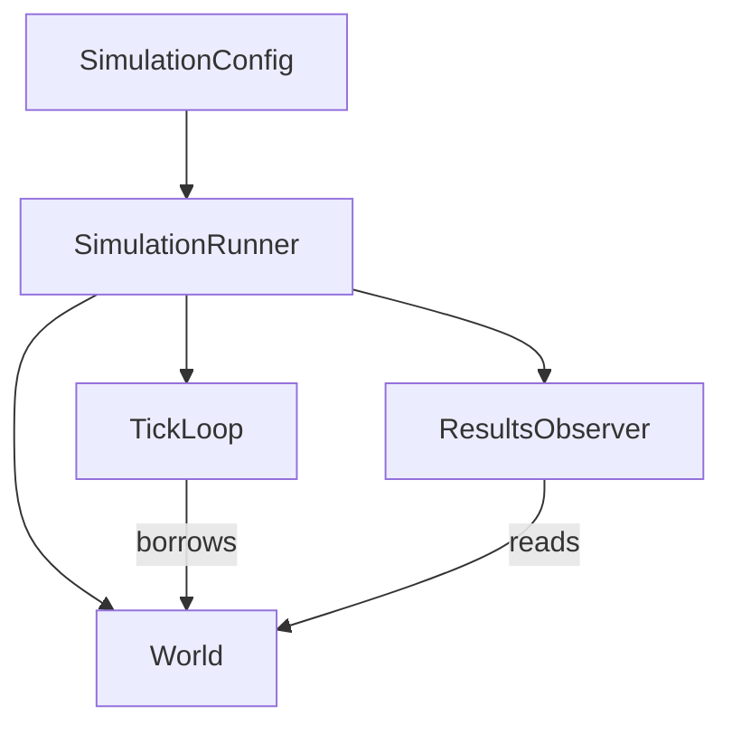
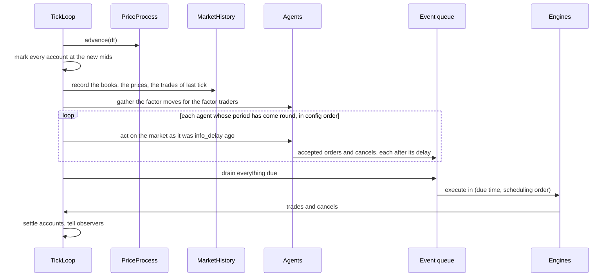

# The simulation loop

`simulation` turns a config into a run. Three objects do the work: a `World` that holds
the state, a `TickLoop` that advances it, and a `SimulationRunner` that owns both and
adds results.

## The config

`SimulationConfig` is plain data:

- the assets, with a symbol, a starting price, a volatility, a drift and a tick size,
- the correlation and the price process,
- the agents, in the order they act,
- the account rules, which apply to every account alike,
- `book_depth`, how many levels of each side an agent sees,
- the master seed, `dt` and the number of ticks.

It validates little by itself. Each part is checked by whatever uses it, where the other
values it must agree with are at hand. A correlation that is not positive definite fails
when `World` builds the covariance, not in some earlier layer that cannot know.

`validate_agent_setup` checks the part about the agents and the exchange in one place,
before the first random draw: a tick size that is not finite and positive, a book depth
below 1, rules that are negative, an agent without a name or two with the same name, a
decision period that is not finite and positive, a bad delay. Everything is checked at
construction, so a bad value throws before the first tick and not deep into a run.

## The world

`World` builds from the config and holds:

- One `PriceProcess` for the whole basket (see [price processes](price-processes.md)).
- One `MatchingEngine` per asset.
- One event queue for everything on its way to an exchange: the orders and cancels of all
  the agents, all assets together.
- One `AgentRuntime` per agent.

An `AgentRuntime` is one agent as the loop holds it: the agent, its account, the list of its
orders, its decision clock, its two random streams and the factor moves gathered for it. It
is also the gateway of [agents](agents.md). It knows no matching engine and no queue, which
is what lets it be tested without running a market.

`World` also checks the config against itself: sizes that must agree, no empty or duplicate
symbol, a factor model asset that has its factor data and a random-walk asset that does not,
a market maker whose strategy has the right number of assets, a factor trader that has a
factor model with one factor per sensitivity.

## One tick

The order is fixed. It is the same in every run, and changing it would change what the
simulation measures.

Rules that matter:

- **Events execute at tick boundaries.** One that falls due between two ticks runs at the
  next tick. Timing is only as fine as `dt`.
- **The order of the config is the order at the exchange.** Messages due at the same
  instant come out in the order they were scheduled, and agents act in the order they are
  listed. An informed trader listed before the market maker therefore hits the previous
  tick's quotes, which are now stale because the price just moved. That is adverse
  selection, and measuring its cost is what the whole simulation is for. Listed after, it
  hits the fresh quotes. It is a choice of the config, not of the loop.
- **A replacement never overtakes its own cancel.** An order sent after a cancel of the same
  asset and side, in the same act, is held back until the cancel is due.
- **An agent never trades with itself.** The engine cancels the older of its own orders
  instead. See [agents](agents.md).

## Executing a message

A submit reaches the engine. While it is being matched, the loop knows which agent is
submitting, so a trade names two order ids and the loop can tell whose they are: a resting
order is in the registry, and the one that is not is the order being submitted.

- Each fill settles the account of the agent, shrinks its order and tells it through
  `on_fill`. A fill of an order still on its way is valid: the order was filled while it was
  being submitted.
- A limit order that is not filled in full and is good-till-cancelled rests. It is recorded
  with its owner and shown as resting.
- An immediate order that did not rest, or one cancelled by self-trade prevention, gives
  back what it held in reserve.
- A cancel is carried out by the engine, which reports it, and that is where the order is
  closed. A cancel for an order already filled away does nothing.

After the tick, the books and the accounts agree: every order the engines hold belongs to
one agent, and every order an agent believes rests is in a book. The tests check this at
every tick, with every kind of agent in the market.

## Latency

Every message takes time to reach the exchange. A delay is a `DelaySpec`: constant, uniform
over a range, or exponential with a mean. A constant delay consumes no random word. Each
agent has its own latency stream for its orders and cancels and for the delay of its
information.

Delays are in the simulation's time unit, so a drawn delay adds straight onto the clock to
give the time a message is due.

## The runner

`SimulationRunner` owns a world, a loop and a results observer. It cannot be copied or
moved, because the loop holds a reference into the world and the observer holds pointers
into its ledgers.

`step()` runs one tick and throws `std::logic_error` past the configured tick count.
`run()` runs the rest and does nothing if the run is finished. Exceptions from deeper
down propagate unchanged. A negative tick count is rejected at construction.

`run_simulation(config)` is the same thing as a free function, for callers that only
want the results, such as a parameter sweep.

A run with no end, for a live GUI, is not a mode of the runner. The application keeps
calling `step()` until told to stop, and the runner does not care. The tick count is a
budget, not a requirement.
